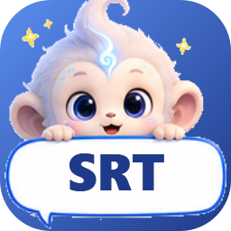

# SRTCONV

로컬 Whisper(faster-whisper)로 영상·음성에서 자막(SRT)을 만들고, 선택한 언어로 자동 번역하는 Windows GUI 프로그램입니다.
인터넷 없이 PC 안에서 동작하며 API 비용이 들지 않습니다.



## 주요 기능
- 영상·음성 파일을 창에 **끌어다 놓기**(여러 개·폴더 가능) 또는 파일 선택
- **언어 자동 감지** 또는 한국어·영어·일본어·중국어·스페인어 등 지정
- **자동 번역**: 한국어, 영어, 일본어, 중국어(간체/번체), 스페인어, 프랑스어, 독일어, 포르투갈어, 이탈리아어, 러시아어, 베트남어, 태국어, 인도네시아어, 아랍어, 힌디어, 터키어
  - 오프라인 M2M100 모델(CTranslate2, MIT) 우선, 없으면 Google → MyMemory 온라인 엔진 순서로 자동 전환
  - 문장 단위로 묶어 번역한 뒤 원래 자막 타이밍에 맞춰 다시 배분
- **SRT 보기**: 완료된 행을 두 번 클릭하거나 "자막 보기" 버튼을 누르면 원문·번역본이 같은 타이밍 기준으로 나란히 표시됩니다.
  셀을 두 번 클릭해 바로 수정하고 "수정 저장"으로 파일에 반영할 수 있으며, "SRT 열기…"로 아무 SRT 파일이나 볼 수 있습니다.
- NVIDIA GPU(CUDA) 자동 사용, 없으면 CPU
- 원본 파일은 변경하지 않으며, 기존 SRT 를 덮어쓰지 않음(`_2`, `_3` 자동 부여)
- 결과: `영상이름_자막_en.srt`(원문), `영상이름_자막_ko.srt`(번역) …
- 앱 아이콘은 베이블링(Vaveling) 캐릭터 '바브'(말풍선 버전)입니다 (`build_tools/make_icon.py`).

## 설치 (릴리스 다운로드)
[Releases](../../releases) 에서 받습니다. GitHub 파일 크기 제한 때문에 세 개로 나뉘어 있습니다.

| 파일 | 필수 | 내용 |
|---|---|---|
| `SRTCONV-vX.Y.Z-win64.zip` | 필수 | 프로그램 본체. 압축을 풀면 `SRTCONV\SRTCONV.exe` 가 생깁니다. CPU 만으로도 동작합니다. |
| `SRTCONV-vX.Y.Z-model-m2m100.zip` | 권장 | 오프라인 번역 모델(M2M100, 약 480MB). 압축을 풀어 나온 `models` 폴더를 `SRTCONV\` 안에 넣습니다. 없으면 온라인 번역 엔진을 씁니다. |
| `SRTCONV-vX.Y.Z-cuda-pack.zip` | 선택 | NVIDIA GPU 가속용 CUDA·cuDNN DLL. 압축을 풀어 나온 DLL 들을 `SRTCONV\_internal\` 안에 넣습니다. GPU 가 없으면 필요 없습니다. |

최종 폴더 모양:
```
SRTCONV\
  SRTCONV.exe
  SRTCONV-cli.exe
  _internal\            (+ cuda-pack 의 DLL)
  models\m2m100_418M-ct2-int8\
```

Whisper 음성 인식 모델은 처음 실행 시 "모델이 없으면 자동 다운로드"를 켜면 HuggingFace 에서 받아
`%USERPROFILE%\.cache\huggingface\hub` 에 저장됩니다(large-v3 약 3GB, small 약 0.5GB).

## 사용법
1. `SRTCONV.exe` 실행
2. 영상 파일을 창에 끌어다 놓기
3. 오른쪽에서 음성 언어(자동 감지 권장), 모델, 번역 대상 언어 선택
4. **자막 만들기 시작** → 완료 후 행을 두 번 클릭하면 SRT 보기 창이 열립니다

콘솔 모드: `SRTCONV-cli.exe --cli 영상.mp4 --translate ko,ja --engine auto`

## 오프라인 번역 모델 직접 만들기
`models\m2m100_418M-ct2-int8` 폴더가 EXE 옆에 있으면 인터넷 없이 번역합니다. 릴리스에서 받거나, 직접 변환하려면(transformers·torch 필요):
```
python -m ctranslate2.converters.transformers --model facebook/m2m100_418M ^
  --output_dir models\m2m100_418M-ct2-int8 --quantization int8 ^
  --copy_files sentencepiece.bpe.model vocab.json tokenizer_config.json special_tokens_map.json
```
NLLB-200(`nllb-200-distilled-600M-ct2-int8`)도 같은 방식으로 넣으면 인식하지만, NLLB 는 **CC-BY-NC-4.0(비상업 전용)** 이므로 배포본에 포함하지 않습니다.

## 개발
```
pip install -r requirements.txt
python main.py                 # GUI
python main.py --cli a.mp4 --translate ko
python -m unittest discover -s tests -v
build.cmd                      # 테스트 → 아이콘 → PyInstaller → dist\SRTCONV
python build_tools\make_release.py v1.0.0   # 릴리스용 zip 3개 생성 (release\)
```
구조: `srtconv/ui.py`(화면) · `viewer.py`(SRT 보기) · `worker.py`(스레드) · `pipeline.py`(파일 처리) · `transcriber.py`(Whisper) · `translator.py`(번역 엔진) · `srt_utils.py`(SRT 분할/저장) · `languages.py`(언어표)

## 라이선스
SRTCONV 는 **GPL-3.0** 으로 배포됩니다 ([LICENSE](LICENSE)).
PyAV 에 동봉된 FFmpeg 가 libx264/libx265 를 포함한 GPL 빌드이기 때문에, 실행 파일 배포본 전체가 GPL 조건을 따릅니다.
포함된 서드파티 구성 요소와 모델의 라이선스는 [THIRD_PARTY_NOTICES.md](THIRD_PARTY_NOTICES.md) 를 참고하세요.
프로그램으로 만든 자막 파일에는 아무 제한이 없습니다.
